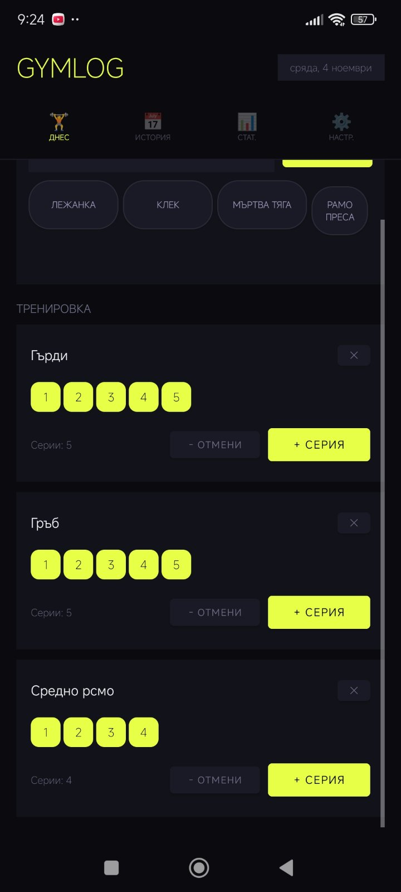

# GymLog 🏋️

Малко Android приложение за записване на тренировки: упражнения, серии, таймер за почивка, история и статистика.
Работи без интернет и без акаунт, а данните остават на телефона ти.

*A small offline Android workout logger (Bulgarian UI): exercises, sets, rest timer, history and stats.*

  

## Функции

- **Днес:** добавяш упражнения (има бързи предложения) и отбелязваш всяка серия с **+ СЕРИЯ**
- **Таймер за почивка** след всяка серия (30 сек, 1 мин, 1:30 или 2 мин) с вибрация в края
- **История** по дни и **статистика** с общ брой серии за всяко упражнение
- Тъмна тема, портретна ориентация

## Изтегляне

1. Отвори [**Releases**](https://github.com/BbJLeB/GymLog/releases/latest) и свали файла `GymLog-vX.Y.Z.apk`.
2. Отвори го на телефона. Android ще поиска да разрешиш инсталиране от неизвестни източници за приложението, през което го отваряш (браузър, файлов мениджър).
3. Изисква **Android 8.0 или по-нов**.

**Обновяване:** инсталирай новия APK директно върху стария, записите се запазват. Деинсталирането на приложението изтрива всички записи.

## Поверителност

Всичко се пази локално на устройството. Приложението няма достъп до интернет (единственото му разрешение е вибрация), няма реклами и не събира данни.

## Билд от код

- **Android Studio:** отвори папката `GymLog/` и пусни приложението.
- **Без Android Studio:** workflow-ът [Build APK](.github/workflows/main.yml) прави debug APK при всеки push. Свали го от **Actions → пускане → Artifacts**.

## Нова версия (за поддържащия)

1. Качи промените в `main`.
2. **Releases → Draft a new release**, избери нов таг (например `v1.0.1`) със **Create new tag on publish** и натисни **Publish release**.
3. Workflow-ът [Release APK](.github/workflows/release.yml) сам билдва подписания APK и го закача към релийза (3–6 минути).

За подписването са нужни четири secrets в репото: `KEYSTORE_BASE64`, `KEYSTORE_PASSWORD`, `KEY_ALIAS`, `KEY_PASSWORD`.

## Лиценз

[MIT](LICENSE)
